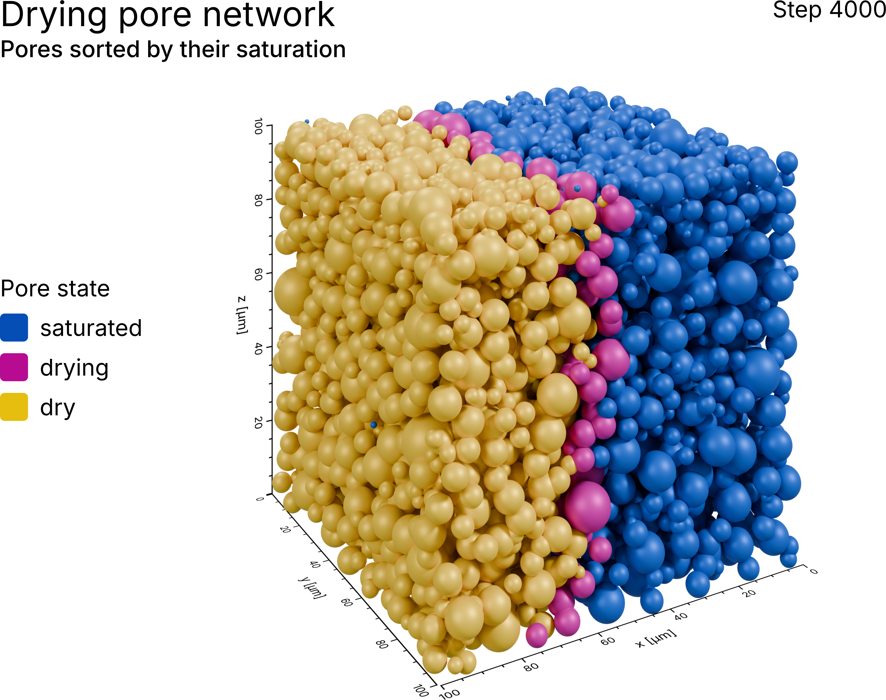
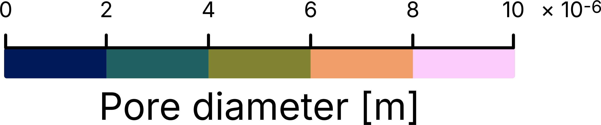
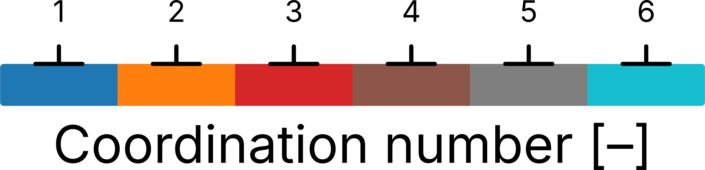
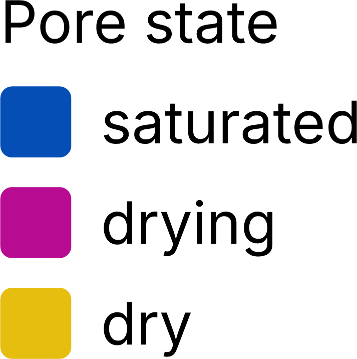

Annotated figure
================

A render rarely explains itself. Before it goes into a manuscript or onto a slide, it
needs the annotations that tell the reader what they are looking at: a title, a colorbar
or a legend for the colors, and -- for a snapshot of a simulation -- the point in time it
shows.

The module :mod:`porescene.layout` draws all of these as SVG and arranges them around a
render on a canvas. This example walks through every kind of annotation it offers: the
three colorbars, a legend, a title and a timestamp. Each annotation is first saved on its
own, and then composed into a finished figure around the render of a drying pore network,
with every pore colored by the state it is in.

The pore network is the one extracted from the freeze-dried sugar solution of the
:doc:`network morphology <network_morphology>` example :footcite:p:`2025_faber_Porescale`,
and the saturation of its pores is taken from a drying simulation on that network. Both
are available in PoreScene's repository on GitHub:
`data/pnm.mat and data/pnm-states.mat <https://github.com/fefafe/porescene/tree/main/data>`_

   The result: the pores of a drying network, sorted into saturated, drying and dry, with
   a title in the upper left corner, the simulation step in the upper right one and a
   legend on the left.

Step-by-step guide
------------------

1. Import required modules
^^^^^^^^^^^^^^^^^^^^^^^^^^

Make sure to have ``porescene`` installed (see :doc:`../installation`). At first, required
modules need to be imported:

.. code-block:: python

   import json
   from pathlib import Path

   from porescene import worker
   from porescene.color.palette import Colormap, Palette, fefa
   from porescene.layout import (
       DiscreteGradientAnnotation,
       LabelsAnnotation,
       SegmentedGradientAnnotation,
       SmoothGradientAnnotation,
       SVGCanvas,
       TextAnnotation,
       TimestampAnnotation,
   )
   from porescene.model import PoreNetwork, StateVariableMap
   from porescene.scene import Scene
   from porescene.utility import CompassDirection, Orientation, px2cm, svg2png

Module :mod:`~porescene.layout` provides the annotations and the
:class:`~porescene.layout.SVGCanvas` they are arranged on: three kinds of colorbar, a
legend (:class:`~porescene.layout.LabelsAnnotation`), a block of text
(:class:`~porescene.layout.TextAnnotation`) and a timestamp
(:class:`~porescene.layout.TimestampAnnotation`). From :mod:`~porescene.utility` come the
:class:`~porescene.utility.Orientation` and :class:`~porescene.utility.CompassDirection`
the annotations are laid out by, :func:`~porescene.utility.px2cm` to measure them, and
:func:`~porescene.utility.svg2png` to rasterize the result.
:class:`~porescene.color.palette.Palette`, :class:`~porescene.color.palette.Colormap` and
the :mod:`~porescene.color.palette.fefa` colors supply the colors.

The render in the middle of the figure needs the same modules as the other network
examples: :class:`~porescene.model.PoreNetwork` and
:class:`~porescene.model.StateVariableMap` load the network and the saturation of its
pores, :class:`~porescene.scene.Scene` sets up the rendering stage, and
:mod:`~porescene.worker` builds and renders the geometry. File paths are handled with the
built-in :mod:`pathlib` module, and :mod:`json` reads the variable mapping.

2. Set utility variables
^^^^^^^^^^^^^^^^^^^^^^^^

After that, the directory holding the input data and the directory receiving the
annotations, the render and the figure are specified:

.. code-block:: python

   # repository root, so the example runs from any working directory
   pth_root = Path(__file__).resolve().parents[1]

   # input data directory
   pth_data = pth_root / "data"

   # output directory, named after this example
   pth_out = pth_root / "tmp" / "example" / Path(__file__).stem
   pth_out.mkdir(parents=True, exist_ok=True)

Both paths are resolved from the location of the script itself, so the example runs from
any working directory. ``pth_data`` holds the input files -- the pore network and its
states -- and is only ever read from, while everything the example writes goes to
``pth_out``, a folder named after the script: ``tmp/example/annotation/``.

Next come the simulation step the figure shows, the margin kept around an annotation that
is saved on its own, and the colors of the three states a pore passes through while it
dries:

.. code-block:: python

   # step of the drying simulation shown in the figure
   no_state = 4000

   # [cm] margin kept around an annotation saved on its own, so its outline is not clipped
   margin = 0.1

   # colors of the three states a pore passes through while it dries
   color_saturated = fefa.darkblue
   color_drying = fefa.pink
   color_dry = fefa.yellow

The state colors are used three times -- by a colorbar, by the legend and by the render
itself -- so they are set once, up front, and every use is bound to agree with the others.

3. Draw the colorbars
^^^^^^^^^^^^^^^^^^^^^

A colorbar is drawn from two things: the colors of the bar, from its low end to its high
end, and the tick labels, in ascending order. The three kinds of colorbar differ in how
they spread the colors along the bar and where they put the ticks.

:class:`~porescene.layout.SmoothGradientAnnotation` blends the colors continuously and
spreads the ticks evenly from one end of the bar to the other. Fed with the three state
colors, it becomes the scale of the saturation, running from dry (``0``) to saturated
(``1``):

.. code-block:: python

   # smooth: the colors blend continuously, the ticks are spread evenly along the bar
   cb_smooth = SmoothGradientAnnotation(
       [color_dry, color_drying, color_saturated],
       ["0", "0.25", "0.5", "0.75", "1"],
   )
   cb_smooth.heading = "Saturation [–]"
   cb_smooth.text = ["Share of the pore volume filled with liquid"]
   cb_smooth.orientation = Orientation.HORIZONTAL

``heading`` names the quantity, and ``text`` adds lines of explanation beneath it. Both
belong to the title block of the colorbar, which always takes the side of the bar that
faces away from the figure, leaving the side facing the figure to the ticks.

   The smooth colorbar.

:class:`~porescene.layout.SegmentedGradientAnnotation` sets the colors in bands of equal
width with hard edges between them, and ticks the boundaries of the bands -- so it takes
one tick more than there are colors. The five colors are picked at equal distances from
the scientific ``BATLOW`` colormap:

.. code-block:: python

   # segmented: the colors stand in bands, ticked on their boundaries -- so there is one
   # tick more than there are colors; the exponent is printed at the high end of the axis
   cb_segmented = SegmentedGradientAnnotation(
       Palette.load(Colormap.BATLOW).subset(5),
       ["0", "2", "4", "6", "8", "10"],
   )
   cb_segmented.heading = "Pore diameter [m]"
   cb_segmented.exponent = -6
   cb_segmented.orientation = Orientation.HORIZONTAL

``exponent`` prints the power of ten the tick values are to be read with at the high end
of the axis, so the labels stay short however small the values are.

   The segmented colorbar.

:class:`~porescene.layout.DiscreteGradientAnnotation` draws bands as well, but every color
stands for a value of its own rather than for a range: the tick sits in the middle of its
band, and the axis is broken up into one dash per tick to match. It suits whole-number
quantities such as the coordination number, here in the qualitative ``TAB10`` colormap,
whose colors are meant to be told apart rather than ordered:

.. code-block:: python

   # discrete: every color stands for a value of its own, ticked in the middle of its band
   cb_discrete = DiscreteGradientAnnotation(
       Palette.load(Colormap.TAB10).subset(6),
       ["1", "2", "3", "4", "5", "6"],
   )
   cb_discrete.heading = "Coordination number [–]"
   cb_discrete.orientation = Orientation.HORIZONTAL

   The discrete colorbar.

.. tip::

   All three colorbars share their settings, documented on
   :class:`~porescene.layout.GradientAnnotation`: a ``color_nan`` swatch for values off
   the scale, a comma as decimal separator, the length and thickness of the bar in
   centimeters, the font sizes in points. To work out the limits and ticks from a range of
   values instead of writing them down, see the :doc:`standalone colorbar <colorbar>`
   example.

4. Draw the legend
^^^^^^^^^^^^^^^^^^

What a colorbar is for a continuous quantity, a legend is for a handful of named states
that carry no scale to put ticks on. :class:`~porescene.layout.LabelsAnnotation` stacks one
colored box per state, with its label next to it:

.. code-block:: python

   # one colored box per pore state, for states that carry no scale to put ticks on
   legend = LabelsAnnotation()
   legend.add_label(color_saturated, "saturated")
   legend.add_label(color_drying, "drying")
   legend.add_label(color_dry, "dry")
   legend.heading = "Pore state"
   legend.title.font_size_heading = 14

The heading of an annotation is set in 21 pt by default, the size of a figure title. Here
it only has to head three labels, so it is brought down to their size through ``title``,
which exposes the title block of the annotation with all its colors and sizes.

   The legend.

5. Save every annotation on its own
^^^^^^^^^^^^^^^^^^^^^^^^^^^^^^^^^^^

Each annotation is put on a canvas of its own and saved to SVG and PNG, to be placed in a
figure that is composed elsewhere -- in a vector graphics editor, say, or in LaTeX:

.. code-block:: python

   for name, element, align in (
       ("cb-saturation", cb_smooth, CompassDirection.SOUTH),
       ("cb-pore-diameter", cb_segmented, CompassDirection.SOUTH),
       ("cb-coordination-number", cb_discrete, CompassDirection.SOUTH),
       ("legend-pore-state", legend, CompassDirection.WEST),
   ):
       canvas = SVGCanvas(padding=(margin,) * 4)
       canvas.add(element, align)

       # shrink the canvas onto the annotation, read only after it knows its edge
       box = element.bbox()
       canvas.size = (px2cm(box.width) + 2 * margin, px2cm(box.height) + 2 * margin)

       svg2png(canvas.save(pth_out / f"{name}.svg"))

The direction an annotation is added under decides more than where it goes: an
annotation lays itself out towards the middle of the canvas, where the figure would be.
A colorbar hung onto the bottom edge (``SOUTH``) carries its ticks on top and its title
underneath; a legend on the left edge (``WEST``) puts its boxes on the left and its labels
on the right, reading towards the figure. That is also why the box of the annotation is
read only after it has been added.

A canvas is 20 by 20 cm unless told otherwise, so it is shrunk onto the annotation to
leave nothing else in the file -- the :doc:`standalone colorbar <colorbar>` example
explains the steps in detail. :func:`~porescene.utility.svg2png` then rasterizes the SVG
next to it, at 600 dpi by default.

6. Render the drying pore network
^^^^^^^^^^^^^^^^^^^^^^^^^^^^^^^^^

The figure needs a render to annotate. As in the
:doc:`network coordination number <network_coordination_number>` example, the pore network
is loaded from ``pnm.mat`` through the variable mapping in ``map_vars.json``:

.. code-block:: python

   # load variable mapping for variable import from .mat file
   with open(pth_data / "map_vars.json") as f:
       map_vars = json.load(f)

   # load pore network data from MAT file
   pn = PoreNetwork.from_mat(pth_data / "pnm.mat", map_vars["data_network"])

The saturation of the pores lives in a file of its own, ``pnm-states.mat``, which holds it
for every step of the drying simulation. A :class:`~porescene.model.StateVariableMap` ties
the quantity ``saturation`` to the variable that stores it per pore -- the throats carry no
saturation, so ``variable_cylinder`` stays unset -- and
:meth:`~porescene.model.PoreNetwork.load_states_from_mat` attaches the chosen step to the
network loaded before:

.. code-block:: python

   # load the saturation of every pore at the chosen step of the drying simulation
   saturation = StateVariableMap("saturation")
   saturation.variable_sphere = "S_p_storage"
   pn.load_states_from_mat(pth_data / "pnm-states.mat", [saturation], [no_state])

By step 4000, more than a third of the pores have dried out. The liquid recedes as a front
through the network: behind it the pores are empty, ahead of it they are still full, and
only the pores within the front are partially saturated. Every pore is therefore sorted
into one of the three states of the legend, and given its color:

.. code-block:: python

   # sort every pore into one of the three states by its saturation
   color_pores = [
       color_saturated if s == 1 else color_dry if s == 0 else color_drying
       for s in pn.states[0].get_quantity("saturation").pore_values
   ]

With one color per pore at hand, the rendering itself follows the
:doc:`network topology <network_topology>` example: the throats are switched off, so the
pores stand out on their own, and :func:`~porescene.worker.make_img` renders the spheres
in the colors given:

.. code-block:: python

   # initialize a new scene
   sc = Scene(pn.extent)

   # disable the throat cylinders so only the pore spheres remain
   sc.config_scene.enable_cylinders = False

   # add spheres to the scene
   worker.build_structure(sc, pn)

   # add axes around the scene
   sc.create_axes()

   # render the scene with every pore colored by its state
   pth_render = worker.make_img(
       pth_out, sc, color_spheres=color_pores, name_spheres="state", no_state=no_state
   )

The render is named after the layer it shows, the coloring and the state:
``sphere-state+axes+state-4000.png``.

.. tip::

   To color the pores by their saturation on a continuous scale instead, register a
   :class:`~porescene.config.QuantityConfiguration` for ``saturation`` and render it with
   :func:`~porescene.worker.make_state_quantity`, as the
   :doc:`network states <network_state>` example does. The smooth colorbar from step 3
   then is the matching scale.

7. Compose the figure
^^^^^^^^^^^^^^^^^^^^^

Two annotations are still missing: a title and the simulation step.
:class:`~porescene.layout.TextAnnotation` takes a heading, a subheading and any number of
body lines. :class:`~porescene.layout.TimestampAnnotation` is a text block whose last line
is the point in time a frame shows, written from a ``prefix``, the value at ``precision``
decimals and a ``unit`` -- here ``Step 4000``, since the simulation step is what the data
counts in:

.. code-block:: python

   # title in the upper left corner, the simulation step in the upper right one
   title = TextAnnotation("Drying pore network", "Pores sorted by their saturation")
   stamp = TimestampAnnotation(no_state, unit="", precision=0, prefix="Step")

The figure is laid out on a canvas of 20 by 16 cm. The render goes into the middle with
:meth:`~porescene.layout.SVGCanvas.add_image`, and the annotations are hung onto the edges
by compass direction with :meth:`~porescene.layout.SVGCanvas.add`:

.. code-block:: python

   # the render goes into the middle, scaled into the room the annotations leave
   canvas = SVGCanvas((20, 16))
   canvas.add_image(pth_render)
   canvas.add(title, CompassDirection.NORTHWEST)
   canvas.add(stamp, CompassDirection.NORTHEAST)
   canvas.add(legend, CompassDirection.WEST)

   svg2png(canvas.save(pth_out / "figure-drying.svg"))

Every edge an annotation is hung onto gives up a strip as thick as the largest annotation
on it, and the render is scaled -- keeping its aspect ratio -- into the rectangle the
strips leave over, so it never runs underneath an annotation:

* ``NORTHWEST`` and ``NORTHEAST`` name a corner, i.e. two edges, and an annotation takes
  the one it lies along. The title and the step are wide, so both go into the strip along
  the top, flushed against its left and its right end.
* ``WEST`` names the left edge alone. The legend goes into the strip along it, centered
  from top to bottom, with its boxes facing the edge and its labels facing the render.

The legend is the very one saved on its own in step 5: an annotation is drawn afresh every
time a canvas is saved, and lays itself out for the canvas it was added to last.

The canvas states its size in centimeters in the SVG it writes, so the figure lands in a
manuscript at 20 by 16 cm, and the render is embedded in the file, so the SVG can be moved
and handed on without it. :func:`~porescene.utility.svg2png` rasterizes the figure next to
it and crops the PNG to its content.

.. tip::

   A colorbar goes onto a figure the same way: ``canvas.add(cb_smooth,
   CompassDirection.SOUTH)`` would put the saturation scale below the render. For the
   frames of a video, keep the canvas and set ``stamp.time`` before saving each frame --
   the label keeps its number of decimals, so it does not jitter from frame to frame.

Full script
-----------

The complete example, also available on GitHub:
`example/annotation.py <https://github.com/fefafe/porescene/blob/main/example/annotation.py>`_.

.. literalinclude:: ../../../example/annotation.py
   :language: python
   :caption: example/annotation.py
   :linenos:

References
----------

.. footbibliography::
