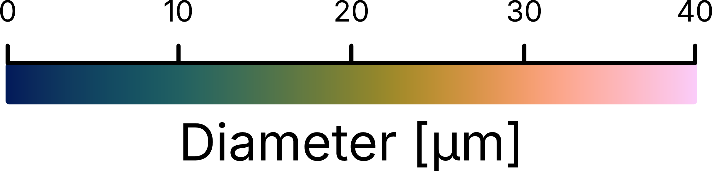
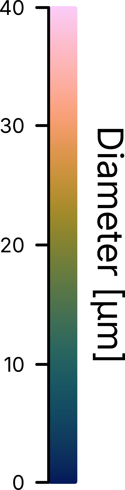

Standalone colorbar
===================

Not every figure is composed in PoreScene. When renders are arranged into panels in a
manuscript, a vector graphics editor or LaTeX, the colorbar is needed as a file of its
own -- one that carries nothing but the scale and arrives at the size it is meant to be
printed at.

This example builds such a colorbar straight from a range of values, using the
annotations of :mod:`porescene.layout`. No scene is set up and no pore network is read,
so Blender is never started: the script works out round limits and ticks for the range,
draws a vertical and a horizontal colorbar from a scientific colormap, and saves each of
them to SVG and PNG on a canvas shrunk to the colorbar itself.

   The result: a horizontal colorbar for pore diameters between 0 and 40 µm, with the
   ticks on top and the heading underneath.

Step-by-step guide
------------------

1. Import required modules
^^^^^^^^^^^^^^^^^^^^^^^^^^

Make sure to have ``porescene`` installed (see :doc:`../installation`). At first, required
modules need to be imported:

.. code-block:: python

   from pathlib import Path

   from porescene.color.palette import Colormap, Palette
   from porescene.layout import SmoothGradientAnnotation, SVGCanvas
   from porescene.utility import (
       CompassDirection,
       Orientation,
       colorbar_limits,
       colorbar_ticks,
       px2cm,
       svg2png,
       tick_labels,
   )

:class:`~porescene.layout.SmoothGradientAnnotation` is the colorbar itself and
:class:`~porescene.layout.SVGCanvas` the sheet it is drawn on. Module
:mod:`~porescene.utility` provides the helpers that turn a range of values into limits
and tick labels, the :class:`~porescene.utility.Orientation` and
:class:`~porescene.utility.CompassDirection` the colorbar is laid out by, and
:func:`~porescene.utility.svg2png`, which rasterizes the result.
:class:`~porescene.color.palette.Palette` loads the colors of a
:class:`~porescene.color.palette.Colormap`. File paths and directories are handled
throughout PoreScene with the built-in :mod:`pathlib` module.

2. Set utility variables
^^^^^^^^^^^^^^^^^^^^^^^^

After that, the directory receiving the colorbars is specified:

.. code-block:: python

   # repository root, so the example runs from any working directory
   pth_root = Path(__file__).resolve().parents[1]

   # output directory, named after this example
   pth_out = pth_root / "tmp" / "example" / Path(__file__).stem
   pth_out.mkdir(parents=True, exist_ok=True)

The path is resolved from the location of the script itself, so the example runs from any
working directory. Everything the example writes goes to ``pth_out``, a folder named after
the script: ``tmp/example/colorbar/``.

To create the colorbar, only the minimum and maximum values of the dataset needs to be given, which is here the smallest and the largest pore diameter of a network, in the unit printed on it. Additionally, it is specified how much empty space needs to stay around the bounding box of the colorbar.

.. code-block:: python

   # [µm] range of the values the colorbar has to cover, e.g. the smallest and the largest
   # pore diameter of a network
   val_min, val_max = 2.7, 37.4

   # [cm] margin kept around the colorbar, so the strokes on its outline are not clipped
   margin = 0.1

3. Work out the scale
^^^^^^^^^^^^^^^^^^^^^

The minimum and maximum values of a dataset are rarely actual ends of the colorbar worth printing.
:func:`~porescene.utility.colorbar_limits` widens the interval outward to round limits -- never
narrowing it, so no value falls outside the gradient -- and
:func:`~porescene.utility.colorbar_ticks` spreads the ticks evenly between them, both
limits included. :func:`~porescene.utility.tick_labels` writes the tick values as labels,
dropping decimals that carry no information:

.. code-block:: python

   # widen the range outward to round limits and spread the ticks evenly between them
   limit_lower, limit_upper = colorbar_limits(val_min, val_max)
   ticks = tick_labels(colorbar_ticks(limit_lower, limit_upper, num_ticks=5))

The range from 2.7 to 37.4 µm becomes a scale from 0 to 40 µm, labelled ``0``, ``10``,
``20``, ``30`` and ``40``.

.. tip::

   Pass ``precision`` to :func:`~porescene.utility.colorbar_limits` to round the limits to
   a fixed decimal place instead -- ``0`` to whole numbers, ``-1`` to whole tens -- or skip
   the helpers altogether and hand the colorbar any tick labels of your own.

4. Draw the colorbar
^^^^^^^^^^^^^^^^^^^^

One colorbar is drawn per orientation, each hung onto the edge of the canvas it is meant
to sit at next to a figure. That edge matters even with no figure on the canvas: the
ticks always face the middle, where the figure would be, and the heading faces away from
it, so a vertical colorbar meant for the right of a render (``EAST``) carries its ticks on
the left, and a horizontal one meant for underneath it (``SOUTH``) carries them on top:

.. code-block:: python

   for orientation, align in (
       (Orientation.VERTICAL, CompassDirection.EAST),
       (Orientation.HORIZONTAL, CompassDirection.SOUTH),
   ):
       cb = SmoothGradientAnnotation(Palette.load(Colormap.BATLOW).all(), ticks)
       cb.heading = "Diameter [µm]"
       cb.orientation = orientation

:class:`~porescene.layout.SmoothGradientAnnotation` blends the colors it is given
continuously -- here the full ``BATLOW`` colormap, one of Fabio Crameri's perceptually
uniform scientific colormaps -- and places the tick labels evenly along the bar.
``heading`` sets its title, which a vertical colorbar carries rotated alongside the bar.

.. tip::

   For colors in bands rather than a continuous blend, swap in
   :class:`~porescene.layout.SegmentedGradientAnnotation` (ticks on the band boundaries)
   or :class:`~porescene.layout.DiscreteGradientAnnotation` (ticks in the middle of each
   band). Every colorbar takes further settings, such as an ``exponent`` printed at the
   high end of the axis or a ``color_nan`` swatch for values off the scale -- see
   :class:`~porescene.layout.GradientAnnotation`.

5. Fit the canvas and save
^^^^^^^^^^^^^^^^^^^^^^^^^^

An :class:`~porescene.layout.SVGCanvas` is measured in centimeters and states that size in
the file it writes, so a figure lands in a manuscript at the size it was laid out at. A
canvas is 20 by 20 cm unless told otherwise, though, which would leave the colorbar
stranded on a large empty sheet. The canvas is therefore shrunk onto the colorbar: its
padding is set to the margin, and its size to the colorbar's box plus that margin on
either side:

.. code-block:: python

       canvas = SVGCanvas(padding=(margin,) * 4)
       canvas.add(cb, align)

       # the canvas is shrunk onto the colorbar, so the file holds nothing else and lands in
       # a manuscript at the colorbar's own size; the box is read only after the colorbar is
       # added, since the edge it sits at decides which sides its ticks and heading take
       box = cb.bbox()
       canvas.size = (px2cm(box.width) + 2 * margin, px2cm(box.height) + 2 * margin)

:meth:`~porescene.layout.AnnotationElement.bbox` reports the rectangle the colorbar fills
in the user units of the SVG, which :func:`~porescene.utility.px2cm` converts into
centimeters. It has to be read after :meth:`~porescene.layout.SVGCanvas.add`: until the
colorbar knows its edge, it cannot tell which side its ticks and heading go on, and with
that how much room it takes.

Finally, :meth:`~porescene.layout.SVGCanvas.save` writes the SVG and
:func:`~porescene.utility.svg2png` rasterizes it next to it -- at 600 dpi by default, and
cropped to the visible content:

.. code-block:: python

       pth = pth_out / f"cb-diameter+{orientation.name.lower()}.svg"
       svg2png(canvas.save(pth))

The SVG is the file to place in a manuscript, since it stays sharp at any zoom; the PNG
serves wherever a raster image is needed. The vertical colorbar comes out as
``cb-diameter+vertical``:

   The vertical colorbar, meant for the right of a render: ticks on the left, the heading
   rotated alongside the bar on the right.

.. tip::

   To pair a colorbar with a render, let the render decide its scale instead:
   :func:`~porescene.worker.make_colorbar` works out the limits from the same data the
   scene was colored on, and :func:`~porescene.image.compose_colorbar` joins the two --
   see the :doc:`network morphology <network_morphology>` example.

Full script
-----------

The complete example, also available on GitHub:
`example/colorbar.py <https://github.com/fefafe/porescene/blob/main/example/colorbar.py>`_.

.. literalinclude:: ../../../example/colorbar.py
   :language: python
   :caption: example/colorbar.py
   :linenos:
