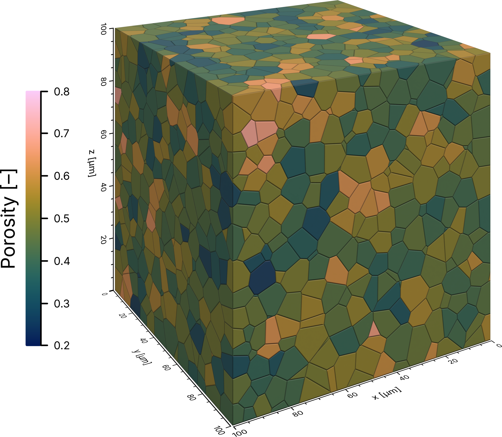

Voronoi cells
=============

A Voronoi tessellation splits the domain of a porous material into one cell per pore:
every point of the domain belongs to the cell of the pore center it lies closest to. Each
cell then stands for the pore and the share of solid around it, which makes the cells a
natural frame for quantities that describe a region rather than the void alone, such as
the local porosity.

This example loads the Voronoi cells of a pore network from a MATLAB file, colors each
cell by its porosity, and renders the cells on the domain boundary together with on-scale
axes and a matching colorbar.

As an example, this tutorial uses the tessellation of the freeze-dried sugar solution
captured with X-ray micro-computed tomographic imaging
:footcite:p:`2025_faber_Porescale` whose pore network is also used in the :doc:`network
topology <network_topology>` example, available in PoreScene's repository on GitHub:
`data/pnm.mat <https://github.com/fefafe/porescene/tree/main/data>`_

   The rendered result: the Voronoi cells on the boundary of the domain, each colored by
   its porosity, with on-scale axes and the matching colorbar.

Step-by-step guide
------------------

1. Import required modules
^^^^^^^^^^^^^^^^^^^^^^^^^^

Make sure to have ``porescene`` installed (see :doc:`../installation`). At first, required
modules need to be imported:

.. code-block:: python

   from pathlib import Path

   import h5py
   import numpy as np

   from porescene import image
   from porescene.color.gradient import SmoothGradient
   from porescene.color.palette import Colormap, Palette
   from porescene.layout import SmoothGradientAnnotation, SVGCanvas
   from porescene.scene import Scene
   from porescene.utility import (
       CompassDirection,
       Orientation,
       colorbar_limits,
       colorbar_ticks,
       svg2png,
       tick_labels,
   )

The tessellation is read straight from the MATLAB file with :mod:`h5py`.
:class:`~porescene.scene.Scene` builds and renders the cells, while
:class:`~porescene.color.gradient.SmoothGradient` turns the porosity of every cell into a
color. :class:`~porescene.layout.SmoothGradientAnnotation` draws the matching colorbar on
an :class:`~porescene.layout.SVGCanvas`, the helpers from :mod:`~porescene.utility` find
its limits and ticks, and :mod:`~porescene.image` joins it to the render.

2. Set utility variables
^^^^^^^^^^^^^^^^^^^^^^^^

After that, the directory holding the input data and the directory receiving the
rendered images are specified:

.. code-block:: python

   # repository root, so the example runs from any working directory
   pth_root = Path(__file__).resolve().parents[1]

   # input data directory
   pth_data = pth_root / "data"

   # output directory, named after this example
   pth_out = pth_root / "tmp" / "example" / Path(__file__).stem
   pth_out.mkdir(parents=True, exist_ok=True)

Both paths are resolved from the location of the script itself, so the example runs from
any working directory. ``pth_data`` holds the input files and is only ever read from,
while everything the example writes goes to ``pth_out``, a folder named after the
script: ``tmp/example/voronoi_cells/``.

3. Load the tessellation
^^^^^^^^^^^^^^^^^^^^^^^^

A tessellation is described by the corners of its cells: one array holds the position of
every corner, and each cell lists the indices of its own corners. Neighboring cells share
corners, so each corner is stored only once. Since MATLAB stores its arrays transposed
and counts from one, every array is turned around and every index lowered by one:

.. code-block:: python

   with h5py.File(pth_data / "pnm.mat") as f:
       # [m] domain dimensions
       extent = np.array(
           [f[k][()].item() for k in ("L_sample_x", "L_sample_y", "L_sample_z")]
       )

       # [m] positions of all cell corners
       pos_corners = np.array(f["pos_cv_corner"]).T

       # indices of the corners of each cell, stored in a MATLAB cell array
       corners = [np.array(f[ref]).ravel().astype(int) - 1 for ref in f["vtx_cv"][0]]

       # indices of the cells touching the domain boundary
       cells_boundary = np.array(f["cv_boundary"]).ravel().astype(int) - 1

       # [-] porosity of each cell
       porosity = np.array(f["epsilon_cv"]).ravel()

``extent`` is the physical extent of the domain in **meters**. It calibrates the axis
ticks and sets the aspect ratio of the scene (see :doc:`../concepts`). The corner
positions are given in meters as well, in the same frame as the pores of the network.
``corners`` holds one array per cell, as a cell has as many corners as its shape
demands. ``cells_boundary`` names the cells that touch the boundary of the domain -- the
only ones to be seen from outside -- and ``porosity`` holds the void fraction of each
cell.

.. tip::

   The tessellation does not have to come from MATLAB: any corner positions and lists of
   corner indices will do, e.g. a Voronoi tessellation computed with SciPy's
   ``scipy.spatial.Voronoi`` and clipped to the domain.

4. Set the color scale
^^^^^^^^^^^^^^^^^^^^^^

The cells and the colorbar have to report one and the same scale, so the limits and the
colors are settled once and used for both. :func:`~porescene.utility.colorbar_limits`
widens the range of the porosity outward to round values, here to one decimal, and
:func:`~porescene.utility.colorbar_ticks` spreads the ticks evenly between them, one per
tenth:

.. code-block:: python

   # widen the porosity range outward to round limits and spread the ticks evenly between
   # them, one per tenth
   limit_lower, limit_upper = colorbar_limits(porosity.min(), porosity.max(), precision=1)
   ticks = tick_labels(colorbar_ticks(limit_lower, limit_upper, num_ticks=7))

   # the cells and the colorbar share one palette and one pair of limits
   colors = Palette.load(Colormap.BATLOW).all()
   gradient = SmoothGradient(colors, limit_lower, limit_upper)

Calling ``gradient`` on an array of values returns one color per value, so it colors all
cells at once.

5. Scene setup and rendering
^^^^^^^^^^^^^^^^^^^^^^^^^^^^

:class:`~porescene.scene.Scene` initializes the rendering stage with camera and lighting,
sized to the extent of the domain. Axes are added around it:

.. code-block:: python

   # initialize a new scene
   sc = Scene(extent)

   # add axes around the scene
   sc.create_axes()

:meth:`~porescene.scene.Scene.create_cells` builds each cell as the convex hull of its
corners. The cells are opaque, so of the 3,913 cells only the 1,228 on the boundary of
the domain can be seen. Passing them as ``selection`` leaves the inner ones out, which
gives the same image in a fraction of the time:

.. code-block:: python

   # add the cells to the scene; the cells are opaque, so only those on the domain boundary
   # can be seen and the inner ones are left out
   sc.create_cells(pos_corners, corners, selection=cells_boundary)

The edges of every cell are rounded off slightly and darkened towards the edge. Where two
cells meet, their rounded edges form a narrow groove that outlines every cell -- also
between neighbors of nearly the same color. This happens in the shading only, so the
cells keep their exact shape and the groove is equally wide on every cell, however short
its edges. The width of the rounded edges is set by ``bevel``, as a fraction of the mean
cell size; it defaults to ``0.05``, while ``0`` keeps the edges sharp and lets cells of
similar color merge.

.. note::

   Building each cell as a convex hull suits tessellations into convex cells, such as
   Voronoi and Laguerre tessellations -- also when they are clipped to the domain. Cells
   that are concave would be filled in.

:meth:`~porescene.scene.Scene.apply_colors` then colors the cells, taking one color per
cell of the tessellation -- including the inner ones that were not built, so the colors
line up with the porosity array without any further indexing. Finally, the scene is
rendered:

.. code-block:: python

   # color each cell by its porosity
   sc.apply_colors("Cells", gradient(porosity))

   # render the scene
   pth_vis = sc.render(pth_out / "cell-porosity+axes.png")

6. Add the colorbar
^^^^^^^^^^^^^^^^^^^

The colorbar is drawn from the same colors and ticks as the cells, as described in the
:doc:`standalone colorbar <colorbar>` example, and saved as SVG and PNG.
:func:`~porescene.image.compose_colorbar` joins it to the left of the render:

.. code-block:: python

   cb = SmoothGradientAnnotation(colors, ticks)
   cb.heading = "Porosity [–]"
   cb.orientation = Orientation.VERTICAL

   # render the colorbar, and compose it with the scene
   canvas = SVGCanvas().add(cb, CompassDirection.WEST)
   pth_cb = svg2png(canvas.save(pth_out / "cb-porosity.svg"))
   pth_img = image.compose_colorbar(
       pth_vis, pth_cb, CompassDirection.WEST, Orientation.VERTICAL
   )

The composite is written next to the render, under the name of the render extended by an
identifier of the colorbar.

Full script
-----------

The complete example, also available on GitHub:
`example/voronoi_cells.py <https://github.com/fefafe/porescene/blob/main/example/voronoi_cells.py>`_.

.. literalinclude:: ../../../example/voronoi_cells.py
   :language: python
   :caption: example/voronoi_cells.py
   :linenos:

References
----------

.. footbibliography::
